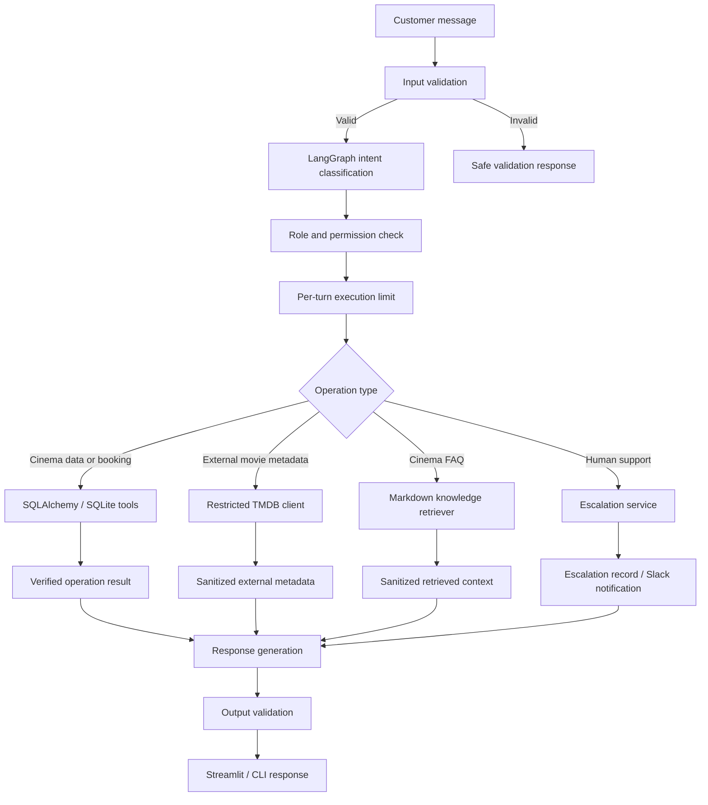

# SmartBook AI

<p align="center">
  <strong>An AI-powered cinema discovery, booking, and customer-support assistant</strong>
  <br />
  Built with LangGraph, OpenRouter, Streamlit, SQLAlchemy, and SQLite.
</p>

<p align="center">
  <a href="https://github.com/ritik-exelance-it/Smartbook_AI">Repository</a>
  ·
  <a href="#getting-started">Getting Started</a>
  ·
  <a href="#features">Features</a>
  ·
  <a href="#architecture">Architecture</a>
  ·
  <a href="#roadmap--future-applications">Future Applications</a>
</p>

---

## Overview

**SmartBook AI** is a conversational cinema assistant designed to make movie discovery, showtime exploration, ticket booking, booking management, and customer support easier through natural-language interaction.

Instead of navigating multiple screens and forms, a customer can ask questions such as:

- “Which movies are available today?”
- “Show me romantic movies.”
- “Tell me about this movie.”
- “Book two tickets for this screening.”
- “Show my upcoming bookings.”
- “I need help with my booking.”

A LangGraph-powered agent interprets the request, extracts relevant details, and routes it to application functions. The backend performs business operations against the local relational database. The language model is responsible for understanding and conversation; it is **not the source of truth** for cinema schedules, ticket prices, seat capacity, or booking records.

SmartBook AI also integrates read-only movie metadata from [The Movie Database (TMDB)](https://www.themoviedb.org/) and can create human-support escalations with Slack notifications.

> **Project status:** This repository is an evolving application/demo. It includes working cinema workflows and supporting integrations, but it is not yet a production-ready ticketing platform. See [Current limitations and production considerations](#current-limitations-and-production-considerations).

## Table of contents

- [Features](#features)
- [How it works](#how-it-works)
- [Architecture](#architecture)
- [Technology stack](#technology-stack)
- [Project structure](#project-structure)
- [Getting started](#getting-started)
- [Environment configuration](#environment-configuration)
- [Running the application](#running-the-application)
- [Using SmartBook AI](#using-smartbook-ai)
- [Booking lifecycle and data ownership](#booking-lifecycle-and-data-ownership)
- [Human support and Slack integration](#human-support-and-slack-integration)
- [TMDB integration](#tmdb-integration)
- [Security and guardrails](#security-and-guardrails)
- [Database and sample data](#database-and-sample-data)
- [Testing](#testing)
- [Current limitations and production considerations](#current-limitations-and-production-considerations)
- [Roadmap & future applications](#roadmap--future-applications)
- [Acknowledgements](#acknowledgements)

## Features

### 1. Natural-language cinema assistant

- Understands conversational requests instead of requiring fixed commands.
- Uses structured intent classification to identify the task and extract relevant fields.
- Supports follow-up conversations for incomplete booking and support requests.
- Maintains conversation state using LangGraph checkpoints.
- Uses bounded LLM retries and request timeouts in the configured OpenRouter client.

### 2. Movie catalogue and discovery

- Browse movies stored in the local cinema catalogue.
- Filter movie listings by supported genres.
- Search for movie titles, including clear partial-name and spelling variations.
- Ask for local movie details and scheduled screenings.
- Distinguish the full catalogue from movies that have upcoming screenings with remaining seats.
- Apply date and time filters where supported by the request and local schedule data.
- Return candidate titles when a movie search is ambiguous instead of silently selecting an uncertain match.

### 3. Showtime and seat availability

- Retrieve scheduled screenings from the local database.
- Display screening date, time, screen, ticket price, and seat information.
- Calculate availability from stored seat capacity and booked-seat counts.
- Exclude past screenings from upcoming availability results.
- Keep cinema availability separate from general movie metadata.

### 4. Guided ticket booking

SmartBook AI follows a confirmation-based booking flow:

1. Understand the booking request.
2. Collect missing details such as movie, ticket count, customer name, and screening.
3. Resolve the movie against the local catalogue.
4. Retrieve valid scheduled screenings from the database.
5. Check that the selected screening has sufficient remaining seats.
6. Calculate and present the booking summary and total.
7. Create the booking only after the customer explicitly confirms the summary.
8. Return the resulting booking details.

The backend validates required fields and seat quantities. Booking creation requires a specific local screening, and an idempotency key is used to protect confirmation retries from creating duplicate bookings.

### 5. Booking management

Customers can use natural language to:

- View their bookings.
- Filter bookings by upcoming or past status.
- Check a booking using its booking ID.
- Request cancellation of an eligible booking.

Booking lookup and cancellation are scoped to the current application user identity, except for trusted administrative operations. Cancellation updates the local booking status and releases the associated seats.

**Cancellation is not payment refund processing.** The current application does not call a payment provider to transfer money back to a customer.

### 6. External movie information through TMDB

SmartBook AI can supplement its local catalogue with read-only TMDB metadata, including:

- Movie overview and synopsis.
- Release date and release year.
- Genres and runtime.
- TMDB rating and vote count.
- Poster and backdrop image URLs.
- Country-specific release certifications, when provided by TMDB.
- Follow-up questions about a previously selected movie.

The TMDB client exposes a restricted set of read-only operations and validates inputs and returned data. External IDs are stored and handled separately from local cinema movie IDs.

**TMDB does not determine local cinema availability.** Only the cinema database can provide local screenings, prices, seat counts, and booking records.

### 7. Human-support escalation

When a customer asks for human assistance or describes an unresolved issue, the application can create a support escalation.

The escalation workflow supports:

- Structured issue classification and priority.
- Collection of customer and booking context.
- Follow-up questions for missing information.
- Contact preference and consent capture.
- Assignment to configured support employees.
- Persistent escalation records in the database.
- Slack notifications using structured Block Kit messages.
- Notification delivery status recorded separately from the ticket.

The escalation record is saved before Slack delivery is attempted. A failed Slack notification does not erase the support ticket. Contact information is included in Slack notifications only when the customer has consented.

This is a ticket/escalation workflow, **not a live human chat system**. It does not guarantee that an employee has seen or responded to a ticket.

### 8. Streamlit chat interface

The Streamlit application provides a user-facing chat experience with:

- A cinema-themed dark interface.
- Conversation creation and history.
- Persisted user and assistant messages.
- A thin UI adapter to the LangGraph backend.
- Booking and conversation continuity using the configured guest identity.

The interface is designed to keep presentation separate from the booking and business logic in the backend.

### 9. Knowledge-base answers

- Retrieves relevant sections from local Markdown knowledge files.
- Uses deterministic keyword matching, inverse-document-frequency weighting, and section-heading boosts.
- Returns a limited number of relevant passages to the agent.
- Preserves a simple retrieval interface for the LangGraph workflow.

The current retriever is a lightweight lexical/keyword-based retrieval system. It is **not** an embedding-based or vector-database RAG pipeline.

## How it works

A typical user request passes through the following stages:

1. **Input validation** — checks that the message is valid and within configured limits.
2. **Intent classification** — the model identifies the requested action and extracts structured fields.
3. **Authorization** — application code checks whether the selected role is allowed to perform the operation.
4. **Execution guard** — limits application tool execution for the current turn.
5. **Backend operation** — deterministic functions query or update SQLite, or call the restricted read-only TMDB client.
6. **Context preparation** — retrieved knowledge and external metadata are treated as untrusted context and filtered before being included in prompts.
7. **Response generation** — the model turns verified tool results into a conversational answer.
8. **Output validation** — validates the assistant response before returning it to the UI.



## Architecture

SmartBook AI is organized around a conversational orchestration layer and deterministic application services.

| Layer | Responsibility |
|---|---|
| Streamlit UI | Presents the chat experience and manages conversation interaction |
| LangGraph agent | Maintains conversation state, classifies requests, routes operations, and composes responses |
| OpenRouter LLM | Provides language understanding and structured intent extraction |
| Middleware | Validates user input, maps intents to permissions, applies execution limits, sanitizes untrusted context, and validates responses |
| Application tools | Implement cinema catalogue, showtime, booking, cancellation, and support operations |
| SQLAlchemy + SQLite | Persist cinema data, bookings, conversations, and escalation records |
| Knowledge retriever | Finds relevant passages in local Markdown knowledge files |
| TMDB client | Fetches restricted, read-only external movie metadata |
| Slack notification service | Sends support escalation notifications to a configured channel |

### Data ownership principle

The application deliberately separates authoritative business data from language-model and external-service context:

| Information | Source of truth |
|---|---|
| Local movie catalogue | SQLite |
| Local showtimes and screens | SQLite |
| Seat capacity and booked seats | SQLite |
| Ticket prices and booking totals | Backend calculation using SQLite records |
| Booking status and ownership | SQLite and backend authorization |
| Support escalation status and assignment | SQLite |
| General external movie metadata | TMDB |
| Cinema FAQs and policy explanations | Local Markdown knowledge files |

The LLM must not invent a screening, availability count, ticket price, booking confirmation, or refund result.

## Technology stack

| Technology | Use |
|---|---|
| Python | Main application language |
| LangGraph | Stateful conversational workflow and orchestration |
| LangChain OpenRouter integration | Model access through OpenRouter |
| OpenRouter | Configurable LLM provider and model selection |
| Pydantic | Structured intent schema and validation |
| SQLAlchemy | Relational database access and ORM |
| SQLite | Local application and conversation persistence |
| LangGraph SQLite checkpointer | Persist conversational graph state |
| Streamlit | Web-based chat interface |
| Requests | HTTP communication with TMDB |
| python-dotenv | Local environment configuration |
| phonenumbers | Phone-number validation and normalization |
| Slack SDK | Support escalation notifications |
| unittest | Automated tests |

## Project structure

The repository is organized into the following main modules. Some supporting data and knowledge files are loaded at runtime.

| File / directory | Purpose |
|---|---|
| `agent.py` | LangGraph state, intent classification, execution routing, booking dialogue, and response generation |
| `app.py` | Streamlit user interface and conversation handling |
| `main.py` | Command-line entry point |
| `tools.py` | Deterministic movie, showtime, booking, conversation, and escalation database operations |
| `db.py` | Database initialization and schema migration |
| `models.py` | SQLAlchemy relational models and database sessions |
| `middleware.py` | Input validation, permission mapping, execution limits, context sanitization, and output checks |
| `knowledge.py` | Markdown knowledge retrieval and passage ranking |
| `contact_validation.py` | Email and phone-number validation/normalization |
| `tmdb_api.py` | Restricted read-only TMDB HTTP client |
| `tmdb_tools.py` | Agent-facing wrappers for TMDB search and details |
| `escalation_flow.py` | Structured support-intent extraction and follow-up flow |
| `escalation_service.py` | Support escalation creation and assignment orchestration |
| `notifications.py` | Slack Block Kit message formatting and delivery |
| `movies_normalized.csv` | Initial movie catalogue seed data |
| `showtimes_normalized.csv` | Initial dated showtime seed data |
| `tests/` | Unit and workflow regression tests |
| `.env.example` | Environment variable template |

Runtime database files such as `cinema.db` and `conversation_checkpoints.sqlite` are created locally and should not be committed with real customer data.

## Getting started

### Prerequisites

- Python 3.10 or newer is recommended.
- Git.
- An OpenRouter API key.
- Internet connectivity for model requests and optional TMDB/Slack integrations.

### 1. Clone the repository

```bash
git clone https://github.com/ritik-exelance-it/Smartbook_AI.git
cd Smartbook_AI
```

### 2. Create a virtual environment

**Windows PowerShell**

```powershell
python -m venv .venv
.\.venv\Scripts\Activate.ps1
```

**Windows Command Prompt**

```bat
python -m venv .venv
.venv\Scripts\activate.bat
```

**macOS / Linux**

```bash
python3 -m venv .venv
source .venv/bin/activate
```

### 3. Install dependencies

```bash
python -m pip install --upgrade pip
pip install -r requirements.txt
```

### 4. Configure environment variables

Copy the example file:

**Windows PowerShell**

```powershell
Copy-Item .env.example .env
```

**macOS / Linux**

```bash
cp .env.example .env
```

Open `.env` and configure at least the OpenRouter values described below.

### 5. Start the application

For the Streamlit web interface:

```bash
python -m streamlit run app.py
```

For the command-line interface:

```bash
python main.py
```

Run the commands from the repository root after activating the virtual environment.

## Environment configuration

The project reads local configuration from `.env`. The following values are relevant:

| Variable | Required? | Description |
|---|---:|---|
| `OPENROUTER_API_KEY` | Yes | API key used to call the configured model through OpenRouter |
| `OPENROUTER_MODEL` | Yes | Model identifier supported by OpenRouter |
| `SMARTBOOK_CHECKPOINT_DB` | No | Path for LangGraph SQLite conversation checkpoints; defaults to `conversation_checkpoints.sqlite` beside the agent |
| `TMDB_READ_ACCESS_TOKEN` | No | TMDB API Read Access Token for external movie metadata |
| `SLACK_BOT_TOKEN` | No | Slack bot token used to send escalation notifications |
| `SLACK_ESCALATION_CHANNEL_ID` | No | Slack channel ID for escalation notifications |
| `LANGSMITH_TRACING` | No | Optional LangSmith tracing toggle |
| `LANGSMITH_API_KEY` | No | Optional LangSmith API key |
| `LANGSMITH_PROJECT` | No | Optional LangSmith project name |
| `LANGSMITH_ENDPOINT` | No | Optional LangSmith endpoint |

Example minimum configuration:

```dotenv
OPENROUTER_API_KEY=your_openrouter_api_key
OPENROUTER_MODEL=provider/model-id
SMARTBOOK_CHECKPOINT_DB=conversation_checkpoints.sqlite
```

Use a model identifier that is currently available to your OpenRouter account. Model availability, pricing, rate limits, and provider behavior can change.

### TMDB configuration

To enable external movie metadata, set:

```dotenv
TMDB_READ_ACCESS_TOKEN=your_tmdb_api_read_access_token
```

Without this token, local catalogue and booking operations remain available; external metadata requests return a configuration message.

### Slack configuration

To enable escalation notifications:

1. Create a Slack app in your workspace.
2. Grant the bot the `chat:write` permission.
3. Install the app in the workspace.
4. Invite the bot to the destination support channel.
5. Add the bot token and channel ID to `.env`.
6. Configure real support employee records in the database before relying on assignment.

Keep the escalation channel private and restrict it to authorized support personnel. Do not send passwords, OTPs, card numbers, CVV, or payment credentials to Slack.

### Secret management

- Never commit `.env`, API keys, access tokens, or real customer data.
- Keep `.env.example` populated with placeholders only.
- Rotate a secret immediately if it is accidentally exposed.
- Use a managed secret store and restricted service credentials for a deployed environment.

## Running the application

### Streamlit UI

```bash
python -m streamlit run app.py
```

Streamlit starts a local web server and prints the local address in the terminal. Open that address in a browser.

### Command-line interface

```bash
python main.py
```

The CLI is useful for testing basic conversational behavior without opening the Streamlit interface.

## Using SmartBook AI

The following are example natural-language requests. Actual results depend on the local database, configured integrations, and current sample schedule.

| Goal | Example |
|---|---|
| Browse catalogue | `List movies` |
| Find available screenings | `Show me available movies` |
| Filter by genre | `Show me romance movies` |
| Movie details | `Tell me about Inception` |
| External movie information | `What is the runtime and release year of this movie?` |
| Start a booking | `Book 2 tickets for Inception` |
| View bookings | `Show my upcoming bookings` |
| Check a booking | `Check booking 12` |
| Cancel a booking | `Cancel booking 12` |
| Ask a policy question | `What is your cancellation policy?` |
| Request human support | `I want to speak to a human` |

### Booking confirmation

A booking request is not the same as booking authorization. SmartBook AI collects the details, verifies a specific screening and seat capacity, presents a summary, and waits for an explicit confirmation before creating the booking.

### Conversation continuity

The Streamlit application stores conversation messages and business records in the application database. LangGraph graph state is persisted separately using the SQLite checkpointer. The checkpoint database path can be customized with `SMARTBOOK_CHECKPOINT_DB`.

## Booking lifecycle and data ownership

The local cinema database is authoritative for all booking-related operations.

A simplified booking lifecycle is:

```text
Request to book
      |
      v
Collect missing details
      |
      v
Resolve local movie
      |
      v
Select local showtime
      |
      v
Validate seat capacity and price
      |
      v
Present booking summary
      |
      v
Wait for explicit confirmation
      |
      v
Create booking in SQLite
      |
      v
Return confirmed booking details
```

Key rules:

- Local `movie_id`, `showtime_id`, `booking_id`, and external `tmdb_id` represent different identifiers and must not be interchanged.
- A TMDB result never establishes that a movie is showing at the cinema.
- Ticket totals are calculated by backend logic from the selected local screening.
- The database and deterministic tools enforce booking ownership and required fields.
- Booking confirmation uses an idempotency key to reduce duplicate creation on retries.
- Cancellation updates local booking status and seat counts; payment refunds are outside the current implementation.

## Human support and Slack integration

The escalation workflow creates a persistent support record and can notify a configured Slack channel.

### Escalation lifecycle

1. The customer describes an issue or requests human support.
2. The agent extracts a supported issue category, priority, and available customer/booking details.
3. The flow asks follow-up questions for missing information.
4. Contact sharing consent is requested before personal contact details are included in Slack.
5. The application creates and assigns an escalation using configured employee data.
6. The notification service attempts to post a structured Slack message.
7. The escalation remains stored even if Slack delivery fails; the delivery status records the outcome.

### Supported routing teams

The current routing setup recognizes:

- `booking_support`
- `billing_support`
- `technical_support`
- `customer_support`

Employee assignment requires employee records to exist in the database. The application should not use fabricated employee identities or placeholder email addresses for real support operations.

## TMDB integration

TMDB is used strictly as an external movie-information provider. The client limits operations to movie search and details lookup by a numeric TMDB ID. It uses a configured Bearer token, bounded request timeouts, input checks, response normalization, and safe user-facing errors.

The integration can enrich a movie conversation with metadata, but it does not write to the local cinema catalogue and does not manage showtimes, seats, pricing, or bookings.

Attribution notice:

> This product uses the TMDB API but is not endorsed or certified by TMDB.

See [TMDB's website](https://www.themoviedb.org/) for its service and API information.

## Security and guardrails

SmartBook AI includes application-level safeguards intended to reduce unsafe or invalid operations. These are useful defense-in-depth controls, not a substitute for production authentication, infrastructure security, or a formal security review.

### Input validation

- Rejects empty or non-string messages.
- Enforces a maximum message length.
- Rejects unsupported control characters.

### Role-based authorization

The current middleware defines customer, support-agent, and admin permission sets. Intent-to-permission mapping is checked before application operations, and database tools also enforce their own permission requirements.

| Role | Intended access |
|---|---|
| Customer | Movie discovery, movie metadata, own booking operations, and human-support requests |
| Support agent | Customer-support operations and escalation review, with the permissions defined in middleware |
| Admin | Operations included in the admin permission set |

**Important deployment requirement:** The role and user identity must be derived from trusted server-side authentication. The current demo's anonymous guest identity is not a secure login system. Never expose the agent's role parameter to an untrusted client as an authorization mechanism.

### Per-turn execution guard

The current middleware sets the maximum application tool execution count to **one per user turn**. This is a conservative guardrail for the current workflow and may need a carefully designed adjustment for future multi-step operations.

### Untrusted-context handling

Retrieved knowledge and external movie metadata are treated as untrusted content. The middleware filters selected instruction-like patterns before these sources are added to the LLM prompt.

This is a defense-in-depth measure, not a complete prompt-injection solution. The deterministic permission checks and database-level validation remain essential.

### Assistant output validation

The response layer checks that the output is a non-empty string, applies a configured length limit, and blocks responses matching selected obvious secret patterns. Catalogue responses use a separate, larger output limit.

### Contact validation and consent

- Email addresses are validated and normalized.
- Phone numbers are parsed, validated, and normalized to E.164 format.
- Slack escalation notifications suppress contact details unless the customer has consented.

### PII helper

The middleware includes a diagnostic redaction helper for common email, phone-number, and secret patterns. It should be integrated into appropriate diagnostic logging before claiming that all application logs are redacted. Do not apply this helper to transaction records that must retain their original business data.

## Database and sample data

The application uses SQLAlchemy with SQLite.

The initial seed data is loaded from:

- `movies_normalized.csv` — local movie identifiers, titles, and genres.
- `showtimes_normalized.csv` — dated screenings, screen identifiers, schedule times, prices, and seat counts.

The application stores relational business records such as movies, showtimes, bookings, conversations, messages, support escalations, and employee assignment data using the project models and database initialization logic.

### Database files

- `cinema.db` stores application business data and conversation messages.
- `conversation_checkpoints.sqlite` stores LangGraph checkpoint state by default.

These files are local runtime data and should be backed up and protected. Do not upload real customer records or production database files to a public repository.

### Migration warning

Database initialization includes migration behavior for the existing project schema. **Back up any existing `cinema.db` before starting a newer version of the application.** Test migrations against a copy of the database before applying them to any important data. This repository's default setup is intended for local development/demo use, not for direct migration of a production database.

## Testing

The repository includes automated tests covering booking operations, database migration, escalation flows, escalation behavior, movie conversations, and Slack notification formatting.

Run the test suite from the repository root:

```bash
python -m unittest discover -s tests -v
```

Run a focused test module:

```bash
python -m unittest discover -s tests -p "test_booking_operations.py" -v
```

Other available test modules include:

- `test_db_migration.py`
- `test_escalation_flow.py`
- `test_escalations.py`
- `test_movie_conversation.py`
- `test_notifications.py`

Tests that contact external services should be configured or mocked appropriately. A passing local test suite does not by itself demonstrate production readiness, security, load capacity, or live payment functionality.

## Current limitations and production considerations

The following limitations should be understood before using SmartBook AI with real customers:

1. **Anonymous guest identity:** The current Streamlit flow uses a guest identity carried through the guest URL parameter. This is not authentication; anyone with the link may act as that guest. Do not share guest links or use this mode for real customer accounts.
2. **Role trust boundary:** Production deployment requires authentication and trusted server-side derivation of user ID and role. A client-supplied role must never grant permissions.
3. **Local SQLite deployment:** SQLite is appropriate for this local demo. A multi-instance, high-concurrency deployment should use a managed relational database and a tested migration strategy.
4. **Knowledge retrieval:** Retrieval is lexical/keyword-based and limited to local Markdown content; it is not vector search or a fully evaluated RAG system.
5. **Prompt-injection protection:** The current context filter catches selected patterns and cannot guarantee that all adversarial instructions will be removed.
6. **Tool execution limit:** One application tool execution per turn is intentionally restrictive. More complex agent workflows will need explicit, bounded, operation-specific policies.
7. **Slack delivery:** Escalations are persisted, but the initial implementation does not provide a durable retry queue, email fallback, or a full employee support workspace.
8. **Payments and refunds:** There is no real payment provider integration or refund execution. A cancellation record is not proof that money has been refunded.
9. **Operational monitoring:** Production deployment needs structured logs, monitoring, alerting, backup/restore procedures, rate limiting, and incident response.
10. **Privacy and compliance:** Define retention, consent, access, deletion, and data-processing policies before collecting real customer data.

## Roadmap & future applications

The architecture is intended to evolve beyond a cinema demo into a more complete conversational customer-service and booking platform. The following are **future applications and planned enhancements**; they are not claims about currently implemented functionality.

### 1. Full cinema booking platform

- Multiple cinema locations and branches.
- Real-time seat maps with seat-level selection and temporary seat holds.
- Multiple screens, formats, languages, and show types.
- Dynamic pricing, discounts, coupons, loyalty points, and membership plans.
- Booking modifications, rescheduling, group bookings, and family packages.
- QR-code or barcode tickets with secure check-in and ticket verification.
- Customer profiles, preferences, and booking history across devices.

### 2. Payment, billing, and refund automation

- Integrate a supported payment gateway through secure server-side APIs.
- Verify payment status using signed webhooks rather than trusting browser redirects.
- Link provider transaction references to local booking records.
- Provide verified payment and invoice inquiries.
- Support refund eligibility checks, approval workflows, and provider-confirmed refund execution.
- Track pending, successful, and failed transactions with an auditable history.
- Apply idempotency and reconciliation to payment and refund operations.

Sensitive payment credentials such as card numbers, CVV, and OTPs should never be stored by SmartBook AI.

### 3. Employee support and operations portal

- Authenticated employee dashboard.
- Central inbox for escalations from chat, email, and other channels.
- Ticket search, filtering, prioritization, reassignment, and escalation.
- Internal notes and complete status history.
- Customer-visible ticket status and secure follow-up messaging.
- SLA timers, response-time metrics, and resolution analytics.
- Configurable team routing and on-call schedules.

### 4. Omnichannel AI customer support

- Deploy the same agent capabilities across website chat, mobile apps, WhatsApp, and other approved channels.
- Maintain a consistent customer identity and conversation history across channels.
- Route complex or sensitive cases to human employees.
- Add email notifications and a resilient notification fallback system.
- Support multilingual conversations and localized cinema policies.

### 5. Advanced movie discovery and personalization

- Embedding-based semantic search over catalogue and approved knowledge content.
- Personalized movie recommendations based on explicit preferences and consent.
- Search by mood, themes, cast, language, duration, and viewing preferences.
- Better movie-similarity and recommendation ranking.
- Carefully sourced content guidance using region-specific classification data.
- Personalized alerts for new releases, screenings, and saved titles.

### 6. Advanced AI orchestration and reliability

- Explicit multi-tool plans with operation-specific budgets.
- Human approval for sensitive or irreversible actions.
- Stronger prompt-injection evaluations and untrusted-content isolation.
- Structured output schemas for every tool boundary.
- Model fallback and provider failover.
- Evaluation datasets for intent accuracy, booking correctness, and response quality.
- Tracing, latency monitoring, token/cost analytics, and automated regression tests.

### 7. Analytics and cinema management

- Admin dashboards for bookings, occupancy, revenue, and cancellation trends.
- Screening performance and demand analysis.
- Reports by movie, screen, location, date, and time.
- Demand forecasting to support scheduling decisions.
- Configurable catalogue, showtime, pricing, and employee management.
- Audit trails for administrative actions.

### 8. Multi-tenant SaaS offering

The longer-term architecture could support multiple cinema businesses from one platform, with strict tenant isolation.

Potential capabilities include:

- Independent cinema accounts and staff roles.
- Tenant-specific catalogues, schedules, prices, branding, and policies.
- Configurable integrations and notification channels.
- Subscription plans, usage metering, and billing for cinema operators.
- Tenant-level analytics and administration.
- Centralized platform operations with isolated customer data.

### Long-term vision

The long-term goal is to evolve SmartBook AI into a **modular AI-powered customer experience platform for entertainment and other appointment- or inventory-based businesses**. The cinema workflow can serve as the first domain-specific implementation, while the underlying architecture—conversational orchestration, deterministic business tools, database-backed transactions, human escalation, and guarded integrations—can be adapted to other industries.

Possible adjacent applications include event ticketing, theatre and live-show reservations, sports venue bookings, attraction and activity reservations, and other service businesses that need conversational discovery, availability checks, secure transactions, and human support.

Each new domain would require its own data model, business rules, integrations, permission design, and testing. The current cinema implementation should be treated as a foundation for that direction, not as evidence that these additional domains are already supported.

## Acknowledgements

- [LangGraph](https://www.langchain.com/langgraph) for stateful agent orchestration.
- [OpenRouter](https://openrouter.ai/) for model access.
- [Streamlit](https://streamlit.io/) for the web interface.
- [SQLAlchemy](https://www.sqlalchemy.org/) for relational database access.
- [The Movie Database (TMDB)](https://www.themoviedb.org/) for optional external movie metadata.

---

<p align="center">
  <sub>SmartBook AI · Conversational cinema discovery, booking, and support</sub>
</p>
